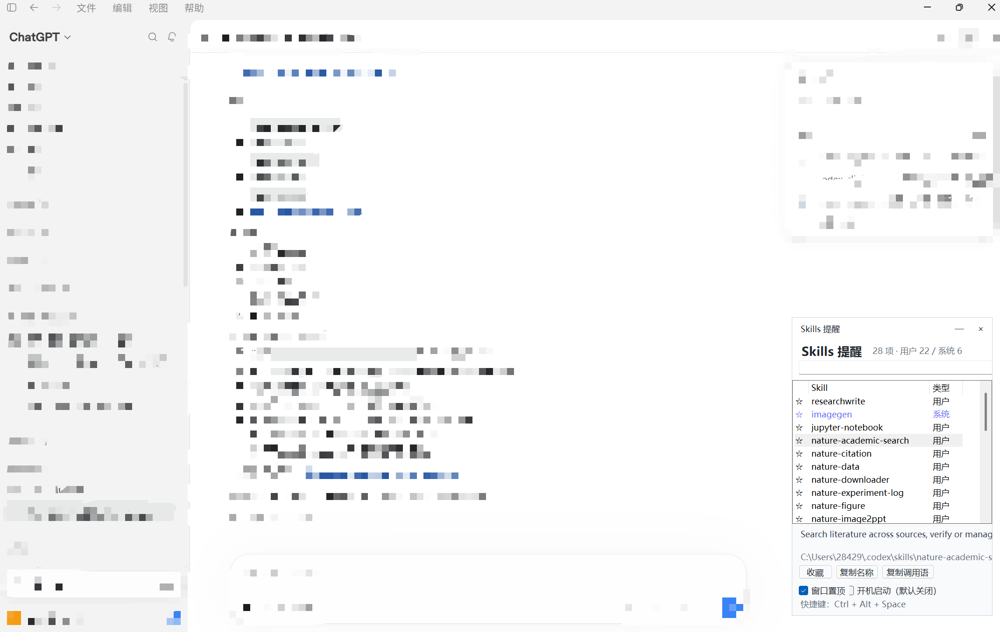

# Skills Reminder for Windows

一个轻量、只读的 Windows 11 Skills 提醒组件，用于快速查看本机 Codex Skills、搜索说明并复制调用语句。

> [!IMPORTANT]
> 本项目是社区独立项目，与 OpenAI、ChatGPT、Codex 或 [Skills Manager](https://github.com/cchao123/skills-manager) 无官方隶属、授权或背书关系。程序不会嵌入、修改或注入官方客户端。

## 界面预览



截图由项目维护者提供，聊天区域经过模糊处理。公开截图前请自行检查其中的路径和 Skill 名称。

## 主要功能

- 自动读取 `%USERPROFILE%\.codex\skills`，支持普通目录和根目录 Junction。
- 分别识别普通 Skills 与 `.system` 系统 Skills。
- 搜索 Skill 名称、ID 和说明。
- 收藏常用 Skill，并按最近使用时间排序。
- 复制 Skill 名称，或复制 `请使用 $skill-name 帮我完成：` 调用语句。
- 中文白色无阴影界面，支持窗口置顶和 Per-Monitor V2 高 DPI。
- 使用 `Ctrl + Alt + Space` 全局显示或隐藏。
- 可选跟随 ChatGPT/Codex 窗口，默认关闭。
- 可选开机启动，默认关闭，修改前会要求确认并备份原注册表值。
- 托盘常驻；关闭面板只会隐藏，从托盘菜单选择“退出”才会完全结束程序。

## 系统要求

- Windows 11 x64。
- .NET Framework 4.8；Windows 11 通常已包含。
- 从源码构建时需要 Windows PowerShell 5.1 和系统自带的 C# 编译器。
- 默认 Skills 目录为 `%USERPROFILE%\.codex\skills`。

当前项目没有正式安装器和自动更新功能，建议仅用于测试和个人使用。

## 快速开始

### 1. 获取源码

```powershell
git clone https://github.com/xiong-H6776/skills-reminder-windows.git
Set-Location -LiteralPath '.\skills-reminder-windows'
```

### 2. 构建

```powershell
& '.\build.ps1'
```

构建脚本使用 Windows 自带的 .NET Framework 编译器，不会下载第三方依赖。成功后会在项目根目录生成 `SkillsReminder.exe`。

如果 PowerShell 阻止运行下载的脚本，可以先检查脚本内容，再执行：

```powershell
Unblock-File -LiteralPath '.\build.ps1'
& '.\build.ps1'
```

### 3. 运行

```powershell
& '.\SkillsReminder.exe'
```

首次运行不会删除、停用、迁移、覆盖或安装任何 Skill，也不会自动开启开机启动或窗口跟随。

## 界面操作

| 操作 | 效果 |
|---|---|
| 搜索框 | 按名称、ID 或说明筛选 Skills |
| 单击列表项 | 查看 Skill 说明和本地目录 |
| 双击列表项 | 复制推荐调用语句 |
| 收藏 | 将当前 Skill 固定到列表前部 |
| 复制名称 | 复制 Skill ID，例如 `imagegen` |
| 复制调用语句 | 复制 `请使用 $imagegen 帮我完成：` |
| 窗口置顶 | 控制组件是否保持在其他窗口上方 |
| 跟随 GPT 窗口 | 控制是否随 ChatGPT/Codex 的前台、最小化和退出状态自动隐藏或恢复 |
| 开机启动 | 经确认后写入当前用户的启动项；默认关闭 |

### 跟随功能

“跟随 GPT 窗口”默认关闭，并会记住上次选择：

- 未勾选：组件不会因 ChatGPT/Codex 被覆盖、最小化或退出而自动隐藏。
- 勾选：切换到其他应用、最小化或退出 ChatGPT/Codex 时自动隐藏；返回客户端时恢复。
- 操作组件自身时不会触发误隐藏。
- 手动使用 `Ctrl + Alt + Space` 显示时，手动操作优先。

### 快捷键与托盘

- `Ctrl + Alt + Space`：显示或隐藏组件。
- 标题栏最小化按钮：隐藏到托盘。
- 标题栏关闭按钮：隐藏到托盘。
- 双击托盘图标：显示组件。
- 托盘菜单“退出”：完全结束程序和窗口监测。

如果快捷键已被其他软件占用，界面底部会显示注册失败提示；此时仍可使用托盘菜单。

## 数据与权限

当前测试版的数据目录为：

```text
D:\CodexData\SkillsReminder
```

其中可能包含：

- `favorites.txt`：收藏记录。
- `recent.tsv`：最近使用记录。
- `follow-client.txt`：窗口跟随开关。
- `startup-registry-backup.txt`：首次修改开机启动项之前保存的原值。

程序执行以下本地操作：

- 只读扫描 `%USERPROFILE%\.codex\skills` 下的 `SKILL.md`。
- 将用户主动复制的文本写入 Windows 剪贴板。
- 仅在用户确认开机启动时，修改 `HKCU\Software\Microsoft\Windows\CurrentVersion\Run`。
- 识别 ChatGPT/Codex 的顶层窗口状态，但不读取聊天内容。

程序不包含网络请求、云端同步、遥测、广告、客户端注入或聊天数据采集。详细说明见 [PRIVACY.md](PRIVACY.md)。

> [!NOTE]
> 数据目录目前仍为开发者环境的固定 D 盘路径，这是公开预览版的已知限制。正式 Release 前应改为 `%LOCALAPPDATA%\SkillsReminder` 并提供可配置路径。

## 安全边界

- Skill 文件始终只读。
- 不执行 `SKILL.md` 中的命令或脚本。
- 不安装市场 Skill，不进行 GitHub 同步。
- 不修改 ChatGPT/Codex 客户端文件、进程或通信。
- 不需要管理员权限运行。
- 当前自行构建的 EXE 没有 Authenticode 数字签名。

下载或接收第三方构建的 EXE 时，请优先核对发布者提供的 SHA-256，并使用 Windows Defender 扫描。

## 项目结构

```text
SkillsReminder/
├─ SkillsReminder.cs
├─ build.ps1
├─ app.manifest
├─ README.md
├─ PRIVACY.md
├─ THIRD_PARTY_NOTICES.md
├─ LICENSE
└─ docs/images/
```

## 卸载与回滚

1. 在托盘菜单中选择“退出”。
2. 如果启用了开机启动，建议先在界面中取消勾选；也可以检查当前用户的 `Run` 注册表项。
3. 删除你保存程序文件的目录。
4. 如需删除收藏和最近记录，先备份数据目录，再删除数据文件。

程序不会安装系统服务、驱动或浏览器扩展。

## 常见问题

### 没有识别到 Skills

确认 `%USERPROFILE%\.codex\skills` 存在，并且每个 Skill 目录内含可读取的 `SKILL.md`。根目录可以是 Junction。

### 系统 Skill 没有显示

系统 Skills 应位于 `%USERPROFILE%\.codex\skills\.system\<skill-name>\SKILL.md`。

### 组件切换到其他程序时仍然显示

这是默认行为。需要自动跟随时，请勾选“跟随 GPT 窗口”。

### 勾选跟随后组件不见了

如果 ChatGPT/Codex 当前不在前台，组件会隐藏到托盘。按 `Ctrl + Alt + Space`，或者双击托盘图标即可临时显示。

### 关闭按钮为什么没有退出

关闭按钮设计为隐藏到托盘。需要完全退出时，请使用托盘菜单中的“退出”。

### Windows 提示未知发布者

当前项目没有付费代码签名证书，自行构建或未签名 Release 可能显示该提示。请从可信仓库获取源码或发布包，并核对哈希。

## 开发状态与计划

公开发布前的剩余事项记录在 [PUBLIC_RELEASE_CHECKLIST.md](PUBLIC_RELEASE_CHECKLIST.md)，主要包括数据路径便携化、干净环境构建验证、Release 打包和代码签名评估。

欢迎通过 Issues 报告问题，但提交前请移除截图、日志和路径中的个人信息。

## 许可证与致谢

本项目以 [MIT License](LICENSE) 发布。

项目功能设计受到开源项目 [Skills Manager](https://github.com/cchao123/skills-manager) 启发。Skills Manager 同样采用 MIT License；本项目为独立实现。详情见 [THIRD_PARTY_NOTICES.md](THIRD_PARTY_NOTICES.md)。
